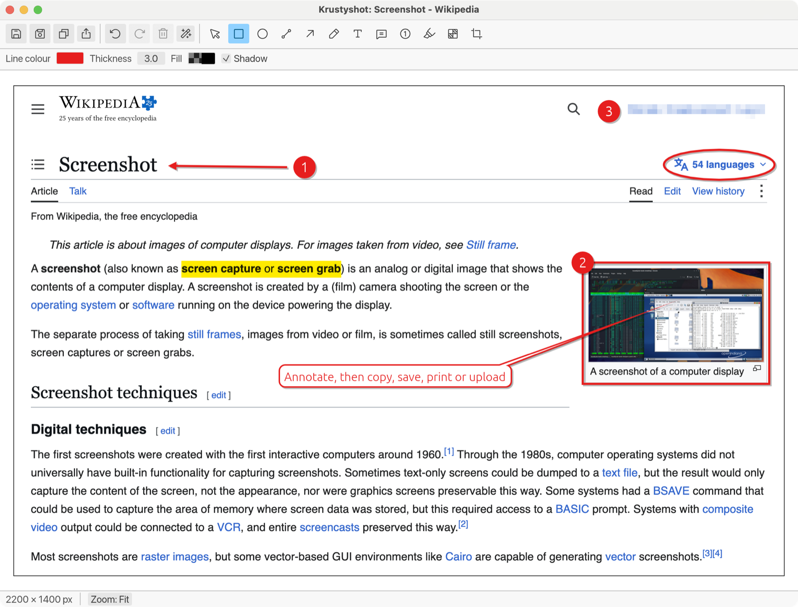
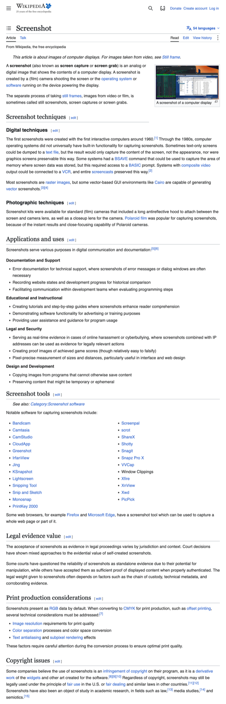
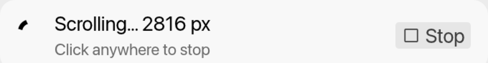
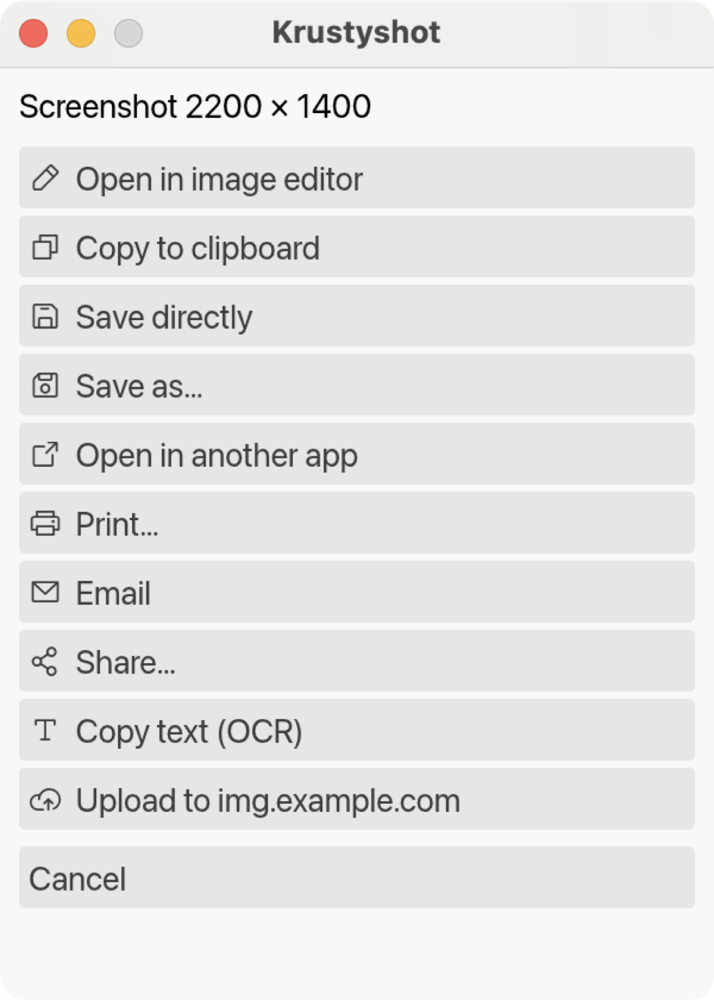
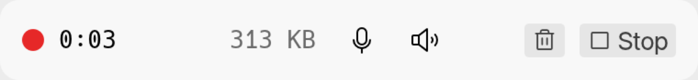
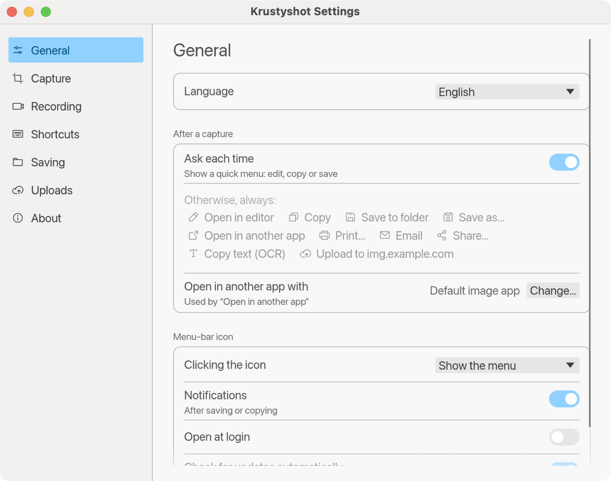
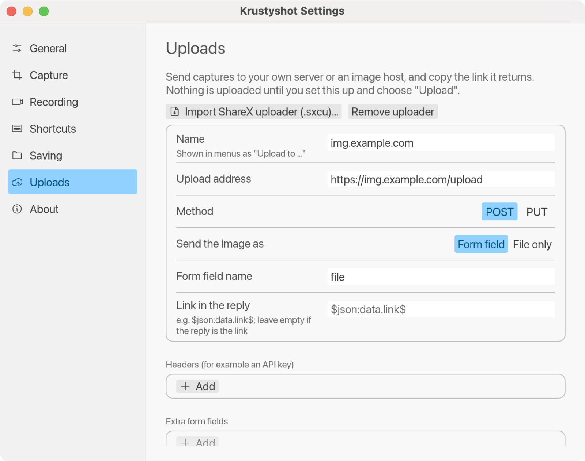

# Krustyshot

**The Greenshot workflow on every desktop.** Press a key, drag over what you want, mark it up, and send it where it needs to go, on macOS, Windows and Linux. Written in Rust with [egui](https://github.com/emilk/egui).

<p align="center"></p>

Krustyshot was called Rustshot until version 0.6.0; the name changed because another screenshot app is called Rustshot.

## Where it shines

- **Whole pages in one picture.** Scrolling capture scrolls a web page or document for you and joins it into one tall image, with fixed headers and footers appearing once.
- **Screenshots and screen recordings in one tool.** Record a region, a window or a display to MP4 or GIF, with your microphone and the computer's sound, without leaving the app you use for screenshots.
- **A real editor, not just a crop tool.** Arrows, numbered steps, speech bubbles, highlights, blur and effects, all editable until you save.
- **Ten places to send a capture.** Clipboard, file, another app, printer, email, Share, text recognition, or your own upload server, from one quick menu.
- **One tool, every computer.** The same shortcuts, menus and editor on macOS, Windows and Linux, in English, French, Spanish and German.
- **Private by default.** No account, no analytics. Nothing leaves your computer unless you print, email, share or upload it; see [what Krustyshot sends](#what-krustyshot-sends-over-the-internet).

## Features

### Capture

- **Region:** the screen freezes, then drag an area with a crosshair, a magnifier and a live pixel size. Regions can span several displays.
- **Window:** hover to highlight a window, click to capture it. Space switches between region and window mode, as in Greenshot.
- **Full screen:** the display the pointer is on, or all displays together.
- **Last region:** capture the same area again with one key.
- **Scrolling region:** see below.
- **Options:** capture delay, include the mouse pointer or leave it out, and open images from the clipboard or a file.

### Scrolling capture



Drag over something taller than the screen, such as a web page, a document or a chat history, and Krustyshot does the scrolling:

- It scrolls, waits for the page to settle, and joins each new part onto the image.
- Fixed headers and footers appear once, not on every screen.
- It stops by itself at the bottom, when you click, or at 25,000 pixels.
- The result goes to the editor, clipboard or any other destination, like any screenshot.



The picture on the right was taken this way: one drag over a Wikipedia article. On macOS this needs the Accessibility permission (asked the first time); on Linux it needs X11.

<br clear="right">

### Edit and annotate

- **Shapes and lines:** rectangle, ellipse, line, arrow and freehand, with colour, thickness, fill and a soft drop shadow.
- **Text and callouts:** text, speech bubbles with a tail you can point anywhere, and step counters that renumber themselves when one is deleted.
- **Highlight:** marker, spotlight (darken everything else), grey out the rest, or magnify.
- **Hide things:** pixelate or blur passwords, names and anything else private.
- **Image tools:** crop, rotate, resize, border, torn edges, drop shadow, greyscale and invert.
- Everything stays editable (select, move, resize, delete) until you save, with unlimited undo and redo.

| Key | Action |
|---|---|
| `R` `E` `L` `A` `F` `T` `S` `I` `H` `O` `C` | Rectangle, ellipse, line, arrow, freehand, text, speech bubble, step counter, highlight, obfuscate, crop |
| `Esc` | Select tool (or cancel crop / clear selection) |
| Shift while drawing | Squares and circles; lines snap to 45° |
| Delete | Remove the selected annotation |
| Enter | Apply crop |
| ⌘Z / ⌘⇧Z | Undo / redo |
| ⌘S / ⌘⇧S | Save / save as |
| ⌘C | Copy image |
| ⌘P | Print |
| ⌘+ / ⌘− / ⌘0 | Zoom in / out / fit |

On Windows and Linux use Ctrl instead of ⌘.

### Send it anywhere



After each capture, a quick menu offers every destination, or you can pick the ones that should always happen:

- **Editor:** annotate first, then send from the editor's own menu.
- **Clipboard** and **Save directly** (to your folder, with a Greenshot-style file name pattern) or **Save as**, in PNG, JPG, BMP or GIF.
- **Open in another app:** your default image app, or one you choose.
- **Print**, and **Email** (a new message with the image attached).
- **Share** on macOS: AirDrop, Messages, Notes and the rest of the Share menu.
- **Copy text (OCR):** recognises the text in the image and copies it, on your own computer (Vision on macOS, Windows' built-in OCR, Tesseract on Linux).
- **Upload** to your own server or an image host, and copy the link it returns. Set the address, headers and fields yourself, or import a ShareX uploader (`.sxcu`).

Notifications after saving or copying let you show the file with one click.

<br clear="right">

### Record the screen



- **Region, window or full screen**, from the menu or the recording shortcut.
- **MP4** on macOS and Windows (the system's own H.264 encoder) and **GIF** everywhere. GIFs store only what changed between frames, so they stay small.
- **Sound in MP4s:** the microphone (choose which one) and the computer's own sound (macOS 13 or later, and Windows), mixed into one track. Click the microphone or speaker icon on the bar to mute or unmute it.
- **Show mouse clicks**, so viewers can follow along.
- While recording a region or a window, the rest of the display is dimmed and a red line marks the area. The bar, the dimming and the outline never appear in the video.
- Quality, resolution and frame rate settings, with an estimate of the size per minute. Recordings stop safely and keep what they have if the disk fills up.

Press the recording shortcut (or choose **Stop recording**) to finish. **Discard** asks before deleting.

### Settings and languages

<p align="center">&nbsp;</p>

- Every change applies straight away. Record a new shortcut by pressing it.
- English, French, Spanish and German, following the system language or chosen in Settings.
- Open at login, a choice of what clicking the menu-bar icon does, notifications, and a daily check for new versions (which you can turn off).
- Low disk space warnings for your screenshots folder.

## Keyboard shortcuts

| Action | macOS | Windows / Linux |
|---|---|---|
| Capture region | ⌥⇧R | Print Screen |
| Capture window | ⌥⇧W | Alt+Print Screen |
| Capture full screen | ⌥⇧F | Ctrl+Print Screen |
| Capture last region | ⌥⇧L | Shift+Print Screen |
| Capture scrolling region | ⌥⇧S | Ctrl+Alt+Print Screen |
| Start or stop recording | ⌥⇧V | Ctrl+Shift+Print Screen |

Change them in Settings → Shortcuts. macOS keeps ⌘⇧3/4/5 for its own screenshot tool.

See [CHANGELOG.md](CHANGELOG.md) for what changed in each version and [docs/ROADMAP.md](docs/ROADMAP.md) for what's planned.

## Install

Download the package for your platform from the [releases page](https://github.com/moridin1138/krustyshot/releases).

- **macOS:** unzip and move `Krustyshot.app` to Applications, then open it. macOS warns the first time; see [Security warnings when installing](#security-warnings-when-installing). Updates keep the Screen Recording, Microphone and Accessibility permissions.
- **Windows:** unzip and run `krustyshot.exe`. Windows may warn the first time; see below.
- **Linux:** extract and run `krustyshot`. It needs GTK 3 and an appindicator library.

**Coming from Rustshot (0.5.1 or earlier)?** Quit Rustshot, install Krustyshot as above, and delete the old Rustshot app (on macOS, `Rustshot.app` in Applications; on Windows, `rustshot.exe`). Your settings, shortcuts and permissions carry over, and Open at login switches to Krustyshot the first time it runs.

### Security warnings when installing

Krustyshot is free, made by one developer, and its downloads aren't signed with a paid certificate (Apple charges US$99 a year, and Windows signing about US$120 a year). The free signing programmes for open-source projects don't apply either: they require an OSI-approved licence, and Krustyshot's [licence](#license) isn't one. So macOS and Windows can't confirm who made Krustyshot, and warn you the first time. That doesn't mean anything is wrong with the app. Here's what to expect, and how to check what you're running.

**Mac:** the first time you open it, macOS says it can't verify the developer.
- On macOS 15 (Sequoia) and later: choose **Done**, then go to System Settings → Privacy & Security, scroll down, choose **Open Anyway** next to Krustyshot, and confirm.
- On macOS 11 to 14: right-click (or Control-click) the app in Finder, choose **Open**, then **Open** again.

You do this once per download. Every release is signed with the same Krustyshot certificate, so macOS treats updates as the same app and keeps your Screen Recording and Microphone permissions.

**Windows:** SmartScreen may show "Windows protected your PC". Choose **More info**, then **Run anyway**. On PCs with **Smart App Control** turned on (Windows Security → App & browser control), Windows blocks unsigned apps outright and offers no way to run them. Turning Smart App Control off is possible, but Windows only lets you turn it back on by resetting or reinstalling Windows, so decide that for yourself.

**Linux:** no warnings.

**How to know what you're getting:**

- Every download on the [releases page](https://github.com/moridin1138/krustyshot/releases) is built by this repository's GitHub Actions workflows from that release's public source code, not on anyone's own computer.
- Each release includes `SHA256SUMS.txt`, and GitHub shows each file's checksum on the releases page. To check a download, run `shasum -a 256 Krustyshot-*.zip` (macOS and Linux) or `Get-FileHash Krustyshot-*.zip` (Windows PowerShell), and compare.
- You can read every line of the source here, and [build Krustyshot yourself](#build-from-source) if you'd rather.

#### What Krustyshot sends over the internet

- **Update check:** a request to GitHub's public API for the latest version number, shortly after start-up and once a day. Turn it off in Settings → General. **Check for updates** in Settings → About asks only when you click it.
- **Uploads:** only to an uploader you set up yourself (Settings → Uploads), and only when you choose **Upload**.
- **Nothing else.** There's no analytics or tracking. Text recognition (Copy text) runs on your computer. Email, Share and Print hand the image to your own apps.

### macOS permissions

Screenshots and recordings need **Screen Recording** permission. macOS asks the first time Krustyshot runs. If it's missing, Krustyshot shows a window explaining how to turn it on (System Settings → Privacy & Security → Screen Recording, then restart Krustyshot); when running with `cargo run`, give the permission to your terminal app instead. Recording the microphone also needs **Microphone** permission, which macOS asks for when you turn the Microphone switch on in Settings → Recording. **Capture scrolling region** needs **Accessibility** permission, so it can scroll other apps; macOS asks the first time you use it.

## Build from source

You need a stable Rust toolchain ([rustup](https://rustup.rs/)).

```bash
cargo run --release -p rustshot-app
```

On Linux, install the system libraries listed in [.github/workflows/ci.yml](.github/workflows/ci.yml) first.

Build a macOS app bundle:

```bash
cargo build --release -p rustshot-app
scripts/bundle-macos.sh
```

The bundle is written to `target/release/bundle/Krustyshot.app` and runs as a menu-bar app with no Dock icon.

### Development commands

| Command | What it does |
|---|---|
| `cargo test` | Run the unit tests |
| `cargo clippy --all-targets -- -D warnings` | Lint (CI fails on any warning) |
| `cargo xtask icons` | Regenerate the app icons in `assets/icons/` |
| `scripts/bundle-macos.sh` | Package a release build as `Krustyshot.app` (macOS) |
| `cargo run -p rustshot-editor --example sample -- out.png` | Render every annotation type into a sample image, to check how they look |
| `cargo run --release -p rustshot-core --example record -- out.mp4 5 medium` | Record the main display for 5 seconds without the app (`.gif` for GIF; add `full` for full resolution, `mic` and `system` for sound; `list` instead of a path lists microphones) |
| `scripts/readme-screenshots.sh` | Retake the pictures in `docs/images/` (macOS; see the script for what it needs) |
| `cargo check-windows` | Lint the Windows build from macOS (once: `rustup target add x86_64-pc-windows-gnu`) |
| `RUSTSHOT_LANG=fr cargo run -p rustshot-app` | Run in a particular language |

## Project documents

- [docs/ARCHITECTURE.md](docs/ARCHITECTURE.md): how the code is organised and how a capture flows through it
- [docs/RELEASING.md](docs/RELEASING.md): versioning rules and the release checklist
- [docs/ROADMAP.md](docs/ROADMAP.md): planned phases and the backlog
- [docs/TRANSLATING.md](docs/TRANSLATING.md): fixing translations and adding languages
- [CHANGELOG.md](CHANGELOG.md): release history

## Settings

Settings live in `rustshot.toml` in the platform config folder:

- macOS: `~/Library/Application Support/org.Rustshot.Rustshot/`
- Windows: `%APPDATA%\Rustshot\Rustshot\config\`
- Linux: `~/.config/rustshot/`

## Credits

- Inspired by [Greenshot](https://getgreenshot.org/) (GPL-3.0). Krustyshot is a new implementation and contains no Greenshot code.
- The sample page in the screenshots is the Wikipedia article [Screenshot](https://en.wikipedia.org/wiki/Screenshot) (CC BY-SA 4.0). The screenshots are made with `scripts/readme-screenshots.sh`.
- Icons: [Phosphor Icons](https://phosphoricons.com/) (MIT), via [egui-phosphor](https://github.com/amPerl/egui-phosphor).

## License

Krustyshot is source-available under the [PolyForm Shield License 1.0.0](LICENSE).

In plain terms (the licence text is what counts):

- You can use Krustyshot for free for any purpose, including at work and for commercial projects.
- You can read, modify and share the code, as long as you pass on the licence.
- You can't sell Krustyshot, or offer a product or service that competes with it, including a repackaged or rebranded version.

PolyForm Shield is a "source-available" licence, not an open-source one in the [OSI](https://opensource.org/licenses) sense, because of that last point. For most people it makes no difference: Krustyshot is free to download, use and change.

Version 0.1.0 and earlier commits were published under GPL-3.0-or-later and remain available under those terms. From 0.1.1 onward, Krustyshot uses the PolyForm Shield licence.

Krustyshot's dependencies keep their own licences, all permissive: mostly MIT and Apache-2.0, with some BSD, Zlib, ISC and Unicode, one MPL-2.0 crate, and Mozilla's root certificate list (CDLA-Permissive-2.0). Greenshot inspired the design, but Krustyshot contains no Greenshot code.
